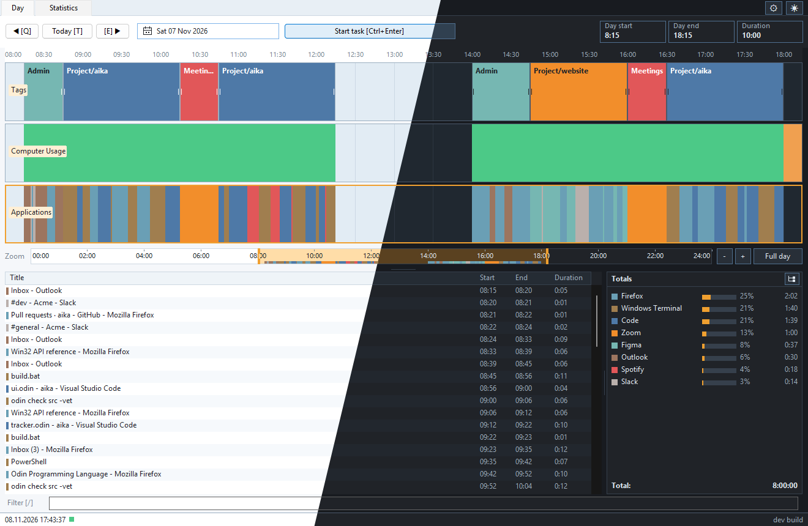

# aika

A small Windows activity tracker and timeline viewer built with **Odin + native Win32/GDI**.
*Aika* is the Finnish word for "time".



It follows the same core design as ManicTime:

- Poll `GetForegroundWindow()` once per second.
- Resolve the owning process, executable path, product name and window title.
- Record a new activity only when the app/title changes.
- Extend the current activity's end time on a heartbeat.
- Store everything in a SQLite database with ManicTime-shaped `Timeline`, `Group`
  and `Activity` tables.
- Import existing ManicTime history from its SQL Server Compact `.sdf` database.

The app is pure Odin at runtime. ManicTime's proprietary `.sdf` file is read by a
built-in, read-only reader that needs no ManicTime libraries or other tools.

Tracking uses a monotonic clock for scheduling. Large system-clock adjustments
split tracking intervals rather than filling the clock jump; a running task stops
at its last saved endpoint. Backward jumps can leave separate intervals overlapping
in UTC—existing history is not moved or repaired automatically.

Day-view bars, lists, totals and tooltips share the same live intervals, including
across midnight. Daily durations are clipped to the selected day; saved and live
versions of the same activity are counted only once.

## Status

Working MVP:

- Foreground-window tracking at 1 Hz
- Idle/away detection (`GetLastInputInfo`, default 1 min without keyboard or mouse input)
- Tracking settings (top-right Settings button or tray menu): 1–500 minute idle timeout, saved per database
- ManicTime-style day view: tab strip, date navigation, full 24 h timeline with
  Tags / Computer Usage / Applications lanes
- Application timeline with live current-activity bar
- Computer usage lane (Active / Away)
- Time tagging: drag a range, search/select or create a tag, resize either edge
- Details list (Title / Start / End / Duration) for the selected lane
- Per-application totals with color chips and a grand total
- Filter box wired to the lists
- Date navigation
- Running tasks (multi-tag) with an optional Pomodoro countdown and tray notification
- Keyboard-friendly: Tab order, shortcuts and key hints (see [Keyboard](#keyboard))
- Automatic tracking pause with retry on persistent write failures (no manual
  pause control yet)
- One-click ManicTime import straight from its `.sdf` database (Settings > Import)
- ManicTime-compatible date semantics (`StartLocalDate` = days since 2000-01-01)

Not implemented yet:

- Session lock / power-off events (`SessionSwitch`, `PowerModeChanged`)
- Document/URL tracking (browser plugins)
- Folders, statistics, general activity editing
- Multi-monitor / per-window tracking (ManicTime also only tracks the foreground window)
- Writing back to `.sdf` (not feasible without the SQL Server Compact engine)

## Build

Requirements:

- Windows
- Odin (tested with `dev-2026-11-nightly:10e57eb`)
- `vendor/sqlite/sqlite3.lib` (already built in this repo)

Run:

```bat
build.bat
run.bat
```

or:

```bat
odin build src -out:build\aika.exe -subsystem:windows
odin build src -out:build\aika-cli.exe
build\aika.exe
```

The UI is drawn with plain GDI (`user32` + `gdi32`, both system libraries), so no
windowing toolkit ships with the binary. A running GUI window uses about 6 MB
of private memory.

The database lives in `%LOCALAPPDATA%\aika\aika.db` by default. Settings > General >
Data folder picks another folder and offers to move your existing files. Override
everything with `--db <path>` (the folder option is then disabled).

## Keyboard

The main canvas (timeline lanes) is mouse-driven; everything else is reachable from
the keyboard. Key hints are shown on the buttons themselves. `Q`, `E`, `T`, `-` and `+`
only act when the main window itself has focus, so typing in the filter box is unaffected.

| Where | Key | Action |
|---|---|---|
| Main window | `/` | Jump to the filter box |
| Main window | `Q` / `E` | Previous / next day |
| Main window | `T` | Jump to today |
| Main window | `-` / `+` | Zoom the Day timeline out / in (numpad works too) |
| Main window | `Ctrl+,` | Open Settings (also works from the filter box) |
| Main window | `F12` | Toggle light / dark theme |
| Main window | `Tab` / `Shift+Tab` | Move between filter, date button and scrollbars |
| Main window | `Ctrl+Enter` | Start / stop the task (Day view) |
| Main window | `Alt+Enter` | Maximize / restore |
| Main window | `Esc` | Cancel the current drag, zoom or tag interaction |
| Filter box | `Esc` | Clear the filter and return focus to the window |
| Filter box | `Ctrl+Backspace` | Delete the previous word |
| Date calendar | `Enter` / `Esc` | Accept the date / close |
| Tag picker | type | Search (typing from the list returns to the search box) |
| Tag picker | `Down` | Move from search into the results list |
| Tag picker | `Enter` | Use the selected tag, or create one if nothing matches |
| Tag picker | `Esc` | Dismiss |
| Start task picker | `Space` | Tick or untick a tag (multi-tag) |
| Start task picker | `Enter` | Add the selected tag |
| Start task picker | `Shift+Enter` | Create a tag from the search text |
| Start task picker | `Ctrl+Enter` | Start the task |
| Start task picker | `Ctrl+P` | Toggle Pomodoro mode and jump to its duration |
| Pomodoro duration | `Enter` | Accept the duration and return to search |
| Settings | `Tab` / `Shift+Tab` | Move between controls |
| Settings | `Enter` / `Esc` | Accept / close |

## Tagging time

Drag left-to-right or right-to-left on the **Tags** lane. Release to open the
tag picker, then search and select an existing tag (double-click or **Use tag**),
or type a new name and click **Create tag**. Enter uses the selected result, or
creates a tag if there are no matches. Escape/Cancel dismisses without saving.

Double-click empty space **between two tag blocks** to select the whole gap,
then choose a tag in the picker. The new block fits exactly between its neighbors.
Empty space before the first block or after the last block is not auto-filled.

Drag either border of a tag block to change its start or end; release to save.
For touching blocks, grab just inside the block whose border you want to resize.
Escape during a drag cancels the change. Selection uses the current zoom range,
without time snapping. Tags appear in the lane, details list, and totals, and
survive restarting the app. Tag blocks cannot overlap: a drag within a block is
a no-op, and dragging out of a block selects only the free time beyond its edge.
Selections stop at the next occupied block; resizing also stops at neighboring
blocks. Renaming tags and moving whole blocks are not yet
implemented.

Right-click a tag block and choose **Delete** to remove that time interval.
The tag name stays available in the picker for reuse.

## Importing existing ManicTime history

aika reads ManicTime's SQL Server Compact 4.0 (`.sdf`) database directly, so
importing is a single button:

1. Open **Settings** (top-right button or tray menu) and go to the **Import** page.
2. Click **Import data from ManicTime**.
3. Confirm the detected `ManicTime.sdf` path. A progress window shows reading and
   writing, and has a Cancel button.

All history is imported. Re-importing is safe: existing data is updated, not
duplicated. The reader is read-only and ManicTime can stay running, but closing it
first gives the most consistent result. Only unencrypted databases are supported.

For scripting, the console build `aika-cli.exe` does the same without the GUI
(`aika.exe` is the GUI build):

```bat
build\aika-cli.exe --db data\aika.db --import-manictime [path\to\ManicTime.sdf]
```

The path is optional and defaults to the local ManicTime database.

Importing from a JSON export is also supported for scripting:
`--import <file.json>`, with `--import-source <id>` for files that carry no source ID.

Imports allocate local IDs, resolve groups by `(TimelineId, Key)`, and preserve
existing group names/colors. Reimporting the same source does not duplicate rows;
source changes update only mapped rows that have not changed locally. Conflicts
roll back the entire import, and locally deleted imported tags stay deleted.
Import failures return exit code 1; invalid CLI arguments return 2.

**Older imports have no provenance.** Back up an existing database before using
the new importer. It will not infer ownership from IDs or rewrite earlier rows:
importing that same legacy history again can create duplicates once. Use a fresh
database for a clean reimport, or review your existing history first. Earlier
overwrites/orphans are not automatically repaired.

## ManicTime schema compatibility

The SQLite schema mirrors the important ManicTime tables and columns:

```sql
Timeline(TimelineId, TypeName, DisplayName, DisplayOrder, UpdateInterval, ...)
"Group"(GroupId, TimelineId, DisplayName, Color, TextData, Key, ...)
Activity(ActivityId, TimelineId, DisplayName, GroupId,
         StartLocalDate, StartLocalTime, StartUtcTime,
         EndLocalDate, EndLocalTime, EndUtcTime,
         StartUtcMs, EndUtcMs, TextData, UpdatedTimestamp)
```

Important details:

- `StartLocalDate` / `EndLocalDate` are **days since 2000-01-01**, exactly like
  ManicTime.
- Local and UTC timestamps are both stored.
- `StartUtcMs` / `EndUtcMs` are an aika extension for fast timeline math; they do not
  change the ManicTime meaning of the other columns.
- `Group.Key` is `Base64(SHA256(lowercase(FileName + ";" + ProductName)))`, matching
  ManicTime's application identity.
- The application group `TextData` is the same
  `<ApplicationGroupTextData>...</ApplicationGroupTextData>` XML.

Timeline IDs seeded by aika:

```
1  ManicTime/Tags
2  ManicTime/ComputerUsage
3  ManicTime/Applications
4  ManicTime/Documents
```

## How it works

```
GetForegroundWindow (1 Hz)
  -> GetWindowThreadProcessId + QueryFullProcessImageNameW
  -> FileVersionInfo (ProductName, CompanyName, FileDescription)
  -> GetWindowTextW (title)
  -> compare (group_id, window title)
  -> ApplicationActivated
  -> activity row start/end
  -> heartbeat extends current row every 10 s
  -> UI loads the day and draws bars
```

Like ManicTime:

- Activities shorter than 5 seconds are merged backward instead of becoming bars.
- The current activity starts as an in-memory overlay and is persisted after 5 s.
- The app timeline is trimmed to the real idle start when the user goes away.
- The current bar grows while the day view is open.

## Layout

```
src/
  main.odin       entry point, native message loop, date navigation
  tracker.odin    foreground polling, idle/away state, activity lifecycle
  tracker_io.odin injectable time/idle/foreground/write callbacks (tests)
  tracker_writes.odin bounded pending-write queue, outage pause, retry
  focus_cache.odin bounded process-instance metadata/group cache
  activity_snapshot.odin effective day projection, write-through cache
  win32.odin      Win32 bindings, time helpers, version info, group identity
  db.odin         SQLite schema/repository, ManicTime-compatible dates
  db_tags.odin    tag/task repository transactions
  db_time.odin    shared timestamp binding
  sqlite.odin     SQLite C bindings
  winui.odin      native window: WndProc, timer, GDI helpers, double buffer, hit tests
  ui.odin         ManicTime-style day view (lanes, ruler, list, totals, tooltip)
  interaction.odin one ui.interaction union, begin/end/cancel
  dpi.odin        central Per-Monitor V2 scaling
  palette.odin    named Palette struct and C_* mirror
  importer.odin   JSON import command (import_apply)
  sdf.odin        native read-only SQL Server Compact (.sdf) reader
  import_sdf.odin ManicTime .sdf -> import_apply
  import_ui.odin  Settings import button and progress window
tools/
  export-manictime.ps1   legacy exporter
vendor/
  sqlite/         SQLite 3.54.1 amalgamation + static lib
docs/
  ARCHITECTURE.md
  DATABASE.md
  DEVELOPMENT.md
  ROADMAP.md
```

## Documentation

| Document | Contents |
|---|---|
| [`AGENTS.md`](AGENTS.md) | Entry point for coding agents: invariants, commands, checklist |
| [`docs/ODIN-PITFALLS.md`](docs/ODIN-PITFALLS.md) | Odin compiler pitfalls hit during the native-UI rewrite (read before touching GDI/UI code) |
| [`docs/ARCHITECTURE.md`](docs/ARCHITECTURE.md) | Tracker, persistence, and UI internals |
| [`docs/DATABASE.md`](docs/DATABASE.md) | Schema, date/group semantics, example queries |
| [`docs/DEVELOPMENT.md`](docs/DEVELOPMENT.md) | Toolchain, build, debugging, common failures |
| [`docs/ROADMAP.md`](docs/ROADMAP.md) | Next features and technical debt |
| [`docs/AUDIT.md`](docs/AUDIT.md) | Project audit backlog and follow-up verification |
